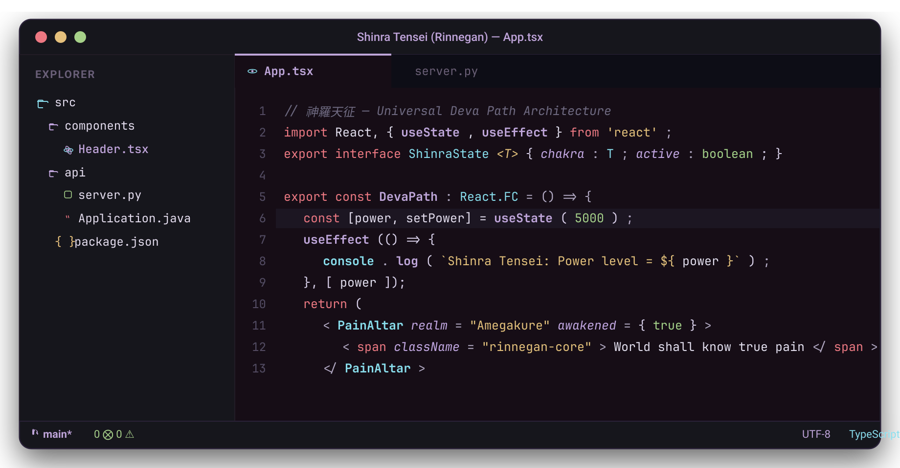

<p align="center">
  
</p>

<h1 align="center">Shinra Tensei Theme</h1>

<p align="center">
  <em>An elegant, dark obsidian and Rinnegan purple theme for <a href="https://code.visualstudio.com">Visual Studio Code</a>, inspired by <strong>Pain (Nagato)</strong> from Naruto Shippuden.</em>
</p>

<p align="center">
  <a href="https://github.com/4ndr3s-00/shinra-tensei-theme/releases/latest"></a>
  <a href="https://marketplace.visualstudio.com"></a>
  <a href="LICENSE"></a>
</p>

<p align="center">
  
</p>

---

## 👁️ Overview

**Shinra Tensei** is built around eye comfort, high contrast, and visual harmony. It replaces washed-out greys and harsh pitch blacks with a deep obsidian canvas (`#131118`) infused with a cold 5% violet undertone, paired with atmospheric chakra accents derived directly from Amegakure (The Hidden Rain) and the concentric ripple eyes of the Rinnegan.

It includes:
- **Three Theme Flavors**: *Shinra Tensei (Rinnegan)* (Balanced), *Shinra Tensei Soft* (Amegakure Rain), and *Shinra Tensei Intense* (Chibaku Tensei).
- **Semantic Highlighting V2**: LSP-powered distinctions for `const` vs `let`, native library types vs user models, generics (`<T, K, V>`), and runtime globals.
- **Comprehensive Syntax Grammar**: Fine-tuned highlighting for modern HTML, CSS/SCSS, JavaScript, TypeScript, React, Next.js, Vue, Python, Rust, Go, and Java.
- **Built-in `Shinra Tensei Icons` Suite**: 656 vector icons crafted on a native 16×16 pixel grid for razor-sharp visual clarity without distortion.
- **Simulated Transparency / Blurred Backdrop**: Optional zero-transparency background support.

---

## ⚡ Theme Variants

| Variant | Atmosphere | Canvas Hex | Accent | Ideal For |
| :--- | :--- | :---: | :---: | :--- |
| **Shinra Tensei (Rinnegan)** | Balanced & Elegant | `#131118` | `#BFA5D9` (Lilac) | Daily coding, balanced contrast |
| **Shinra Tensei Soft** | Amegakure Rain | `#181620` | `#B59CCE` (Muted) | Late-night marathons, low glare |
| **Shinra Tensei Intense** | Chibaku Tensei | `#0A090E` | `#D4B4FF` (Vivid) | OLED displays, maximum contrast & pop |

---

## 🎨 Color Palette (Specification)

| Palette Role | Hex | RGB | HSL | Swatch | Usage |
| :--- | :--- | :--- | :--- | :---: | :--- |
| **Obsidian Canvas** | `#131118` | `19 17 24` | `257° 17% 8%` |  | Main editor background |
| **Amegakure Slate** | `#16131D` | `22 19 29` | `258° 21% 9%` |  | Sidebar, Activity Bar & Panels |
| **Void Elevation** | `#191522` | `25 21 34` | `258° 24% 11%` |  | Inputs, dropdowns & list hover |
| **Selection Purple** | `#272133` | `39 33 51` | `260° 21% 16%` |  | Editor selections & active line highlight |
| **Mist Foreground** | `#E4DEEE` | `228 222 238` | `262° 33% 90%` |  | Primary text, variables & parameters |
| **Rain Mist (Comment)** | `#6F6880` | `111 104 128` | `258° 10% 45%` |  | Comments & docstrings (*italic*) |
| **Rinnegan Lilac** | `#BFA5D9` | `191 165 217` | `270° 43% 75%` |  | Functions, methods & React hooks |
| **Calm Mist Cyan** | `#89DCEB` | `137 220 235` | `189° 71% 73%` |  | Classes, types, CSS properties & JSON |
| **Akatsuki Coral** | `#ED7882` | `237 120 130` | `355° 76% 70%` |  | Keywords, control flow & HTML native tags |
| **Sunset Amber** | `#E5C07B` | `229 192 123` | `39° 67% 69%` |  | Strings & character literals |
| **Sage Chakra Green** | `#A6D189` | `166 209 137` | `96° 44% 68%` |  | Numbers, booleans & CSS class selectors |
| **Soft Mauve** | `#C3A6E1` | `195 166 225` | `270° 50% 77%` |  | Attributes, decorators & annotations |

---

## 🚀 Install

### Via VS Code Extensions Marketplace

1. Open the Extensions sidebar (`Ctrl + Shift + X` or `Cmd + Shift + X`).
2. Search for `Shinra Tensei`.
3. Click **Install**.

### Quick Open

1. Launch VS Code Quick Open (`Ctrl + P` or `Cmd + P`).
2. Paste the following command and press `Enter`:
   ```text
   ext install 4ndr3s-00.shinra-tensei-theme
   ```

### Via VSIX (Direct Download)

1. Download [`shinra-tensei-theme-1.3.0.vsix`](https://github.com/4ndr3s-00/shinra-tensei-theme/releases/latest) from the latest release.
2. Install via terminal:
   ```bash
   code --install-extension shinra-tensei-theme-1.3.0.vsix
   ```
   *(Or in VS Code: Extensions view `...` → **Install from VSIX...**)*

---

## ⚡ Activation

1. **Color Theme**: Press `Ctrl + K` then `Ctrl + T` (or `Cmd + K, Cmd + T`) → Select **`Shinra Tensei (Rinnegan)`**.
2. **File Icon Theme**: Press `Ctrl + Shift + P` → `Preferences: File Icon Theme` → Select **`Shinra Tensei Icons`**.

---

## 📂 Shinra Tensei Icons Suite

Shinra Tensei includes a comprehensive vector icon suite containing **656 crisp icons** tailored for modern development:

- **Mathematical 16×16 Pixel Grid**: Pixel-perfect vector paths (`viewBox="0 0 16 16"`) eliminate blurry edges and distortion in compact file trees.
- **Deep Obsidian & Lilac Folders**: Distinct open and closed folder states with luminous accents and Rinnegan pupil markers.
- **Vibrant File Badges**: Dedicated brand-accurate yet obsidian-harmonized emblems for JavaScript, TypeScript, React, Python, Rust, Go, Java, Docker, Git, Kubernetes, Fish, Bash, and hundreds of language and framework extensions.

---

## 🧠 Semantic Highlighting V2 (LSP Engine)

Shinra Tensei features full Language Server Protocol (LSP) semantic token support:
- **Inmutability Recognition**: `variable.readonly` distinguishes immutable `const` variables from mutable `let` and `var`.
- **System vs Domain Models**: `type.defaultLibrary` and `class.defaultLibrary` distinguish native standard library types (`Promise`, `Array`, `Map`, `dict`, `List`) from your custom interfaces and domain classes.
- **Type Parameters & Generics**: Dedicated accents for generic type parameters (`<T, K, V>`).
- **Enumerations**: Distinct highlighting for `enumMember` constants.
- **Runtime Globals**: Global functions like `fetch`, `setTimeout`, and `console.log` are identified without colliding with local function names.

---

## ⚙️ Recommended Configuration

To get the full developer experience with semantic tokens and font ligatures, add the following to your `settings.json`:

```json
{
  "workbench.colorTheme": "Shinra Tensei (Rinnegan)",
  "workbench.iconTheme": "shinra-tensei-icons",
  "editor.fontFamily": "'JetBrainsMono Nerd Font', 'Fira Code', monospace",
  "editor.fontLigatures": true,
  "editor.semanticHighlighting.enabled": true
}
```

---

## 🧪 Development & Quality Assurance

The extension includes a standalone zero-dependency test suite that validates the theme structure, color consistency, and all 656 vector icons:

```bash
# Validate themes and verify all 656 icons
npm test

# Rebuild all theme JSON files from source palettes
npm run build
```

---

## 🌫️ Simulated Blurred Background (Optional)

If you would like the iconic Pain Chibaku Tensei blurred backdrop inside your editor (independent of your operating system wallpaper):

1. Install the `shalldie.background` extension:
   ```bash
   code --install-extension shalldie.background
   ```
2. Add this configuration to your `settings.json`:
   ```json
   "background.enabled": true,
   "background.useDefault": false,
   "background.customImages": [
     "file:///path/to/shinra-tensei-theme/assets/pain-blurred-bg.png"
   ],
   "background.style": {
     "content": "''",
     "pointer-events": "none",
     "position": "absolute",
     "z-index": "99999",
     "width": "100%",
     "height": "100%",
     "background-position": "center",
     "background-repeat": "no-repeat",
     "background-size": "cover",
     "opacity": 0.4
   }
   ```

---

## 👥 Maintainer

Shinra Tensei Theme is crafted and maintained by:

| [](https://github.com/4ndr3s-00) |
| :---: |
| **[Andrés (4ndr3s-00)](https://github.com/4ndr3s-00)** |
| *Creator & Maintainer* |

---

## 🤝 Contributing

Contributions, language grammar suggestions, and feedback are welcome!
Feel free to open an issue or pull request on [GitHub](https://github.com/4ndr3s-00/shinra-tensei-theme).

---

## 📜 License

Distributed under the **MIT License**. See [`LICENSE`](LICENSE) for details.
