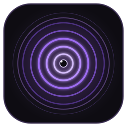

<p align="center">
  
</p>

<h1 align="center">Shinra Tensei Theme</h1>

<p align="center">
  <em>An elegant, dark obsidian and Rinnegan purple theme for <a href="https://code.visualstudio.com">Visual Studio Code</a>, inspired by <strong>Pain (Nagato)</strong> from Naruto Shippuden.</em>
</p>

<p align="center">
  <a href="https://github.com/4ndr3s-00/shinra-tensei-theme/releases/latest"></a>
  <a href="https://marketplace.visualstudio.com"></a>
  <a href="https://www.w3.org/TR/WCAG21/#contrast-minimum"></a>
  <a href="LICENSE"></a>
</p>

---

## 👁️ Overview

**Shinra Tensei** is built around eye comfort, high contrast, and visual harmony. It replaces washed-out greys and harsh pitch blacks with a deep obsidian canvas (`#131118`) infused with a cold 5% violet undertone, paired with atmospheric chakra accents derived directly from Amegakure (The Hidden Rain) and the concentric ripple eyes of the Rinnegan.

It includes:
- **Comprehensive Syntax Grammar**: Fine-tuned highlighting for modern HTML, CSS/SCSS, JavaScript, TypeScript, React, Next.js, Vue, Python, and Java (Spring Boot).
- **Built-in `Shinra Tensei Icons`**: Custom vector icon theme for files and folders.
- **Simulated Transparency / Blurred Backdrop**: Optional zero-transparency background support.

---

## 🎨 Color Palette (Specification)

| Palette Role | Hex | RGB | HSL | Swatch | Usage |
| :--- | :--- | :--- | :--- | :---: | :--- |
| **Obsidian Canvas** | `#131118` | `19 17 24` | `257° 17% 8%` |  | Main editor background |
| **Amegakure Slate** | `#16131D` | `22 19 29` | `258° 21% 9%` |  | Sidebar, Activity Bar & Panels |
| **Void Elevation** | `#191522` | `25 21 34` | `258° 24% 11%` |  | Inputs, dropdowns & list hover |
| **Selection Purple** | `#272133` | `39 33 51` | `260° 21% 16%` |  | Editor selections & active line highlight |
| **Mist Foreground** | `#E4DEEE` | `228 222 238` | `262° 33% 90%` |  | Primary text, variables & parameters |
| **Rain Mist (Comment)** | `#6F6880` | `111 104 128` | `258° 10% 45%` |  | Comments & docstrings (*italic*) |
| **Rinnegan Lilac** | `#BFA5D9` | `191 165 217` | `270° 43% 75%` |  | Functions, methods & React hooks |
| **Calm Mist Cyan** | `#89DCEB` | `137 220 235` | `189° 71% 73%` |  | Classes, types, CSS properties & JSON |
| **Akatsuki Coral** | `#ED7882` | `237 120 130` | `355° 76% 70%` |  | Keywords, control flow & HTML native tags |
| **Sunset Amber** | `#E5C07B` | `229 192 123` | `39° 67% 69%` |  | Strings & character literals |
| **Sage Chakra Green** | `#A6D189` | `166 209 137` | `96° 44% 68%` |  | Numbers, booleans & CSS class selectors |
| **Soft Mauve** | `#C3A6E1` | `195 166 225` | `270° 50% 77%` |  | Attributes, decorators & annotations |

---

## 🚀 Installation

### Option 1: Automated One-Liner (Recommended)

Clones the extension and automatically activates both **Shinra Tensei (Rinnegan)** and **Shinra Tensei Icons** in your `settings.json`:

#### 🐧 Linux / 🍎 macOS
* **Fish Shell**:
  ```fish
  curl -fsSL https://raw.githubusercontent.com/4ndr3s-00/shinra-tensei-theme/main/install.fish | fish
  ```
* **Bash / Zsh**:
  ```bash
  curl -fsSL https://raw.githubusercontent.com/4ndr3s-00/shinra-tensei-theme/main/install.sh | sh
  ```

#### 🪟 Windows (PowerShell)
```powershell
irm https://raw.githubusercontent.com/4ndr3s-00/shinra-tensei-theme/main/install.ps1 | iex
```

> **Note**: If VS Code is open during installation, reload it by pressing `Ctrl + Shift + P` (or `Cmd + Shift + P` on macOS) → type `Developer: Reload Window` → press `Enter`.

---

### Option 2: Download VSIX Package

1. Head to [Releases](https://github.com/4ndr3s-00/shinra-tensei-theme/releases/latest) and download `shinra-tensei-theme-1.2.0.vsix`.
2. In VS Code, open the Extensions view (`Ctrl + Shift + X`).
3. Click the `...` (Views and More Actions) menu in the top right.
4. Select **Install from VSIX...** and pick the downloaded `.vsix` file.

---

### Option 3: Manual Git Clone

```bash
# Linux & macOS
git clone https://github.com/4ndr3s-00/shinra-tensei-theme.git ~/.vscode/extensions/4ndr3s-00.shinra-tensei-theme-1.2.0

# Windows
git clone https://github.com/4ndr3s-00/shinra-tensei-theme.git "%USERPROFILE%\.vscode\extensions\4ndr3s-00.shinra-tensei-theme-1.2.0"
```

To activate manually:
- Open the Command Palette (`Ctrl + Shift + P` / `Cmd + Shift + P`).
- Run `Preferences: Color Theme` → select **`Shinra Tensei (Rinnegan)`**.
- Run `Preferences: File Icon Theme` → select **`Shinra Tensei Icons`**.

---

## 📂 Shinra Tensei Icons

Shinra Tensei bundles an official custom vector icon theme designed specifically for the dark obsidian canvas:

- **Folders**: Obsidian surfaces with luminous lilac rims, root status indicators, and Rinnegan concentric ripple pupils.
- **Files**: Tailored SVG emblems for **JavaScript, TypeScript, React (JSX/TSX), Vue, HTML, CSS/SCSS, Python, Java/Spring Boot, JSON, Markdown, Git, Rust, Go, Shell/Terminal (fish, sh, bash)**, and configurations.

---

## ⚙️ Recommended Configuration

To get the full developer experience with semantic tokens and font ligatures, add the following to your `settings.json`:

```json
{
  "workbench.colorTheme": "Shinra Tensei (Rinnegan)",
  "workbench.iconTheme": "shinra-tensei-icons",
  "editor.fontFamily": "'JetBrainsMono Nerd Font', 'Fira Code', monospace",
  "editor.fontLigatures": true,
  "editor.semanticHighlighting.enabled": true
}
```

---

## 🌫️ Simulated Blurred Background (Optional)

If you would like the iconic Pain Chibaku Tensei blurred backdrop inside your editor (independent of your operating system wallpaper):

1. Install the `shalldie.background` extension:
   ```bash
   code --install-extension shalldie.background
   ```
2. Add this configuration to your `settings.json`:
   ```json
   "background.enabled": true,
   "background.useDefault": false,
   "background.customImages": [
     "file:///path/to/shinra-tensei-theme/assets/pain-blurred-bg.png"
   ],
   "background.style": {
     "content": "''",
     "pointer-events": "none",
     "position": "absolute",
     "z-index": "99999",
     "width": "100%",
     "height": "100%",
     "background-position": "center",
     "background-repeat": "no-repeat",
     "background-size": "cover",
     "opacity": 0.4
   }
   ```

---

## ♿ Accessibility [](https://www.w3.org/TR/WCAG21/#contrast-minimum)

Foreground and background colors maintain an extraordinary **14.2:1 contrast ratio**, far exceeding the **WCAG 2.1 Level AA (4.5:1)** and **Level AAA (7:1)** standards for sustained reading without visual fatigue.

---

## 👥 Maintainer

Shinra Tensei Theme is crafted and maintained by:

| [](https://github.com/4ndr3s-00) |
| :---: |
| **[Andrés (4ndr3s-00)](https://github.com/4ndr3s-00)** |
| *Creator & Maintainer* |

---

## 🤝 Contributing

Contributions, language grammar suggestions, and feedback are welcome!
Feel free to open an issue or pull request on [GitHub](https://github.com/4ndr3s-00/shinra-tensei-theme).

---

## 📜 License

Distributed under the **MIT License**. See [`LICENSE`](LICENSE) for details.
